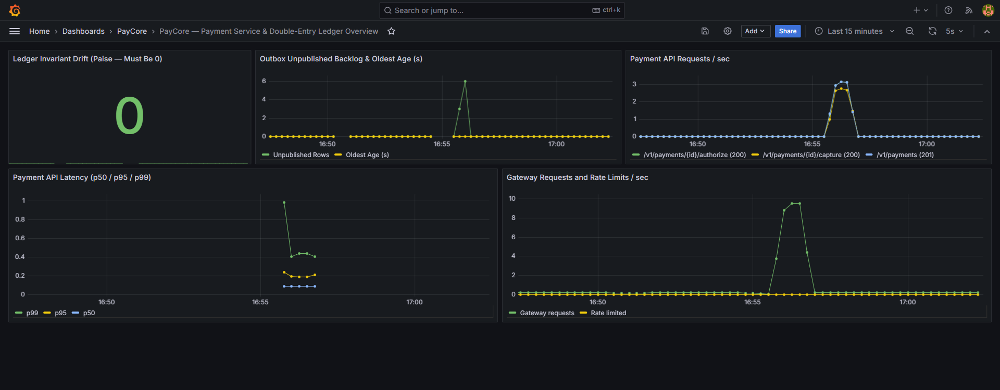
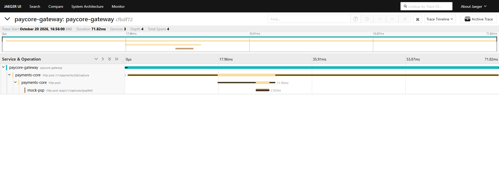
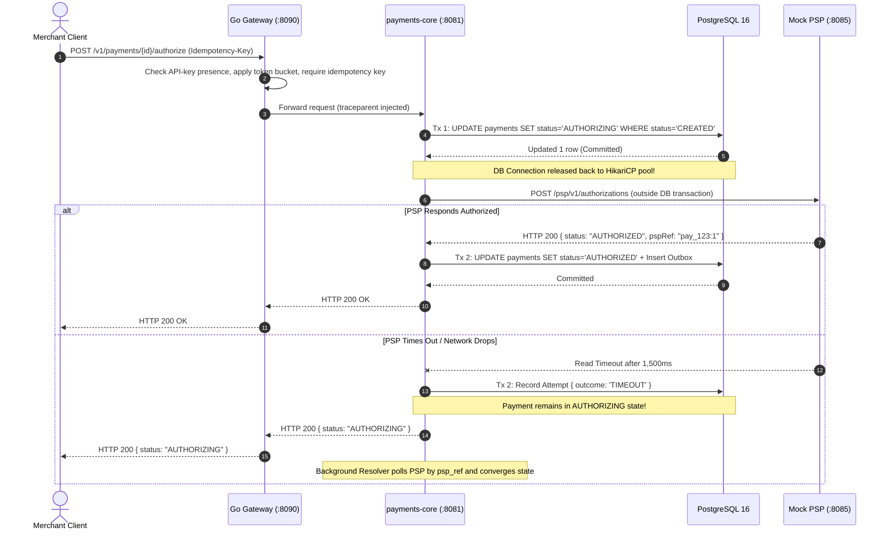
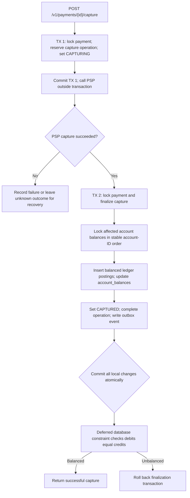
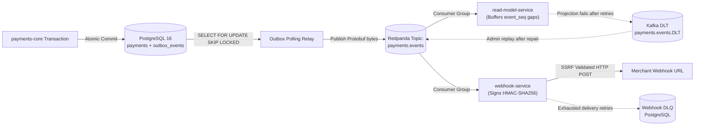

# PayCore Ledger — Payment Orchestration & Double-Entry Ledger

[](https://github.com/Juixe7/Paycore-Ledger/actions/workflows/ci.yml)
[](https://openjdk.org/projects/jdk/21/)
[](https://go.dev/)
[](https://spring.io/projects/spring-boot)
[](https://www.postgresql.org/)
[](https://redpanda.com/)
[](http://localhost:3001)

PayCore is a local payment orchestration and ledger project. It uses a mock PSP and local infrastructure; it does not process real payments.

---

## Table of Contents

- [1. Executive Summary](#1-executive-summary)
  - [1.1 Core Problem Statement](#11-core-problem-statement)
  - [1.2 Technical Philosophy & Invariants](#12-technical-philosophy--invariants)
  - [1.3 High-Level Technology Matrix](#13-high-level-technology-matrix)
- [2. Architecture Overview](#2-architecture-overview)
  - [2.1 Layered Architectural Diagram](#21-layered-architectural-diagram)
  - [2.2 Separation of Concerns & Boundary Enforcement](#22-separation-of-concerns--boundary-enforcement)
- [3. Project Structure](#3-project-structure)
  - [3.1 Directory Tree](#31-directory-tree)
  - [3.2 Module Responsibility Matrix](#32-module-responsibility-matrix)
- [4. Core Features & Subsystems](#4-core-features--subsystems)
  - [4.1 Two-Phase Idempotent Authorization Pattern](#41-two-phase-idempotent-authorization-pattern)
  - [4.2 Double-Entry Ledger and Optional Sharding](#42-double-entry-ledger-and-optional-sharding)
  - [4.3 Concurrent Refund Protection](#43-concurrent-refund-protection)
  - [4.4 Transactional Outbox and Webhook Delivery](#44-transactional-outbox-and-webhook-delivery)
  - [4.5 Settlement Reconciliation](#45-settlement-reconciliation)
- [5. How to Read the Project](#5-how-to-read-the-project)
- [6. Service Layer Documentation](#6-service-layer-documentation)
- [7. API Documentation](#7-api-documentation)
- [8. Configuration Reference](#8-configuration-reference)
- [9. Deployment & Setup Guide](#9-deployment--setup-guide)
- [10. Workflow Diagrams](#10-workflow-diagrams)
- [11. Troubleshooting & Operations Guide](#11-troubleshooting--operations-guide)
- [12. Verification & Empirical Benchmarks](#12-verification--empirical-benchmarks)

---

## 1. Executive Summary

### 1.1 Core Problem Statement
Payment workflows must handle retries, concurrent requests, slow or unavailable PSPs, and events consumed asynchronously. This project explores several ways to keep those workflows consistent:
1. **Auditable money movement**: balances are derived from ledger entries instead of being updated as independent totals.
2. **Database connection usage**: PSP requests run outside the database transaction so a slow network call does not hold a database connection for its duration.
3. **Retries and concurrent operations**: idempotency records and database locking protect against duplicate captures and over-refunds.
4. **State changes and events**: a transactional outbox records events with the corresponding database update; downstream delivery is at least once and consumers handle duplicates.

### 1.2 Technical Philosophy & Invariants
**PayCore Ledger** is organized around a small set of accounting and workflow invariants:
* **Double-entry ledger**: each posted journal transaction balances debits and credits within its currency. The invariant checker and database constraints are intended to reject unbalanced transactions; integration tests verify zero ledger drift for the exercised scenarios.
* **PSP calls outside database transactions**: The service releases its database transaction before calling the PSP. Spring runs requests on JDK 21 virtual threads (configurable) and PSP calls use Resilience4j bulkhead and circuit-breaker limits.
* **Database-Enforced Guardrails**: Correctness does not rely solely on application code. Integrity is anchored at the database engine level via deferred constraint triggers, check constraints, append-only mutation blocks, and lexicographically sorted pessimistic row locks (`SELECT ... FOR UPDATE`).
* **Idempotency and outbox delivery**: request payload hashes detect reuse of idempotency keys with different requests. Outbox rows commit with domain changes and are delivered at least once to consumers.

### 1.3 High-Level Technology Matrix

| Layer / Concern | Technology Stack | Architectural Purpose |
| :--- | :--- | :--- |
| **Edge Ingress Gateway** | Go 1.22 (`net/http/httputil`, OpenTelemetry) | Reverse proxy, API-key-presence checks, per-key token-bucket rate limiting, W3C trace propagation, and OTLP-exported gateway spans. Merchant identity and key validation are enforced by the receiving service. |
| **Domain Orchestration** | Java 21, Spring Boot 3.3.5 | Spring-managed virtual threads, `JdbcClient` with explicit SQL, and HikariCP connection management. |
| **Data Persistence** | PostgreSQL 16 | Range-partitioned ledger and outbox tables, PL/pgSQL deferred balance checks, indexes, and row-level locks. |
| **Event Streaming** | Redpanda (Kafka-compatible), Protobuf v3 | A polling outbox relay publishes versioned payment events for downstream consumers. |
| **Caching & In-Flight Coordination** | PostgreSQL, optional Redis 7, in-process futures | PostgreSQL is authoritative for idempotency; Redis caching is optional and disabled by default. In-process futures reduce duplicate work within one JVM. |
| **Fault Tolerance & Resilience** | Resilience4j, durable PostgreSQL work records, Kafka consumer error handling | PSP calls use bulkhead/circuit-breaker protection; webhook retries use scheduled PostgreSQL records; read-model Kafka failures use a Kafka DLT and replay registry. |
| **Observability & Metrics** | Prometheus, Grafana, OpenTelemetry, Jaeger | Custom Micrometer gauges (`ledger_drift_paise`), HTTP latency distribution (p50/p95/p99), and distributed W3C tracing. |

---

## 2. Architecture Overview

### 2.1 Layered Architectural Diagram

```text
 ┌────────────────────────────────────────────────────────────────────────────────────────┐
 │                                CLIENT / MERCHANT APPLICATION                           │
 └───────────────────────────────────────────┬────────────────────────────────────────────┘
                                             │ HTTP/1.1 (X-API-Key, X-Idempotency-Key)
                                             ▼
 ┌────────────────────────────────────────────────────────────────────────────────────────┐
 │                      TIER 1: EDGE INGRESS GATEWAY (Go 1.22, :8090)                     │
 │  • Token-Bucket Rate Limiter (sync.Map)          • API-key presence & route selection  │
 │  • Idempotency-Key Validation                    • W3C Traceparent Propagation    │
 └───────┬───────────────────────────────────┬────────────────────────────────────┬───────┘
         │ /v1/payments, /v1/payouts         │ /v1/payments (read route)           │ /v1/admin/reconciliation
         ▼                                   ▼                                    ▼
 ┌───────────────────────────────┐ ┌───────────────────────────────┐ ┌────────────────────┐
 │  TIER 2: PAYMENTS-CORE        │ │  TIER 4A: READ-MODEL-SERVICE  │ │  TIER 4B: RECON    │
 │  (Java 21, :8081)             │ │  (Java 21, :8083)             │ │  (Java 21, :8084)  │
 │  • Two-Phase Authorization    │ │  • CQRS Query Views           │ │  • CSV/JSON Ingestion│
 │  • Double-Entry Ledger Engine │ │  • Out-of-Order Gap Buffer    │ │  • 4-Way Match     │
 │  • Idempotency Engine         │ │  • Deterministic Rebuild      │ │  • Discrepancy Log │
 └───────┬──────────────┬────────┘ └───────────────▲───────────────┘ └─────────┬──────────┘
         │              │                          │                           │
         │ External I/O │ PostgreSQL ACID          │ Kafka Payment Events      │ Matches
         ▼ (No DB Lock) ▼ Transaction              │ (Protobuf)                │ Against
 ┌───────────────┐ ┌───────────────────────────────┴───────────────┐           │
 │ MOCK PSP      │ │  TIER 3: DATA PERSISTENCE (PostgreSQL 16)     │           │
 │ (:8085)       │ │  • payments (Mutable Aggregate Root)          │           ▼
 │ • Hold/Capture│ │  • ledger_entries (Append-Only, partitioned)  │ ┌────────────────────┐
 │ • Fault Inject│ │  • accounts & account_balances (optionally sharded)      │ │ PSP SETTLEMENT     │
 │ • Webhook APIs │ │  • outbox_events (Transactional Outbox)       │ │ CSV FILE (T+1)     │
 └───────────────┘ └───────────────────────────────┬───────────────┘ └────────────────────┘
                                                   │ Application polling relay
                                                   ▼
 ┌────────────────────────────────────────────────────────────────────────────────────────┐
 │             TIER 5: ASYNC EVENT BROKER & WEBHOOKS (Redpanda & Webhook Engine)          │
 │  • Topic: payments.events (Protobuf v1)          • webhook-service (:8082)             │
 │  • PostgreSQL-scheduled webhook retries        • HMAC-SHA256 Signature Generation   │
 │  • Webhook DLQ in PostgreSQL                   • SSRF Safe IP Filter & Dispatch      │
 └────────────────────────────────────────────────────────────────────────────────────────┘
```

### 2.2 Separation of Concerns & Boundary Enforcement
1. **Modular Encapsulation**: ArchUnit tests ([`ArchitectureBoundaryTest.java`](payments-core/src/test/java/com/paycore/payments/ArchitectureBoundaryTest.java)) check package dependencies when tests run; they are test-time architecture checks.
2. **Read and write separation (CQRS)**: Payment commands and authoritative payment/ledger reads are served by `payments-core`. The separate `read-model-service` consumes events and serves eventually consistent payment-list and merchant-summary views; it does not replace all core reads.
3. **Transactional outbox (not event sourcing)**: PostgreSQL payment and ledger tables remain the system of record. An outbox row commits with a domain change; a polling relay publishes it to Kafka/Redpanda. Consumers build independent views or deliver webhooks from events.

---

## 3. Project Structure

### 3.1 Directory Tree

```text
Paycore/
├── .github/workflows/ci.yml        # GitHub Actions verification workflow
├── deploy/
│   ├── docker-compose.lite.yml     # Local Postgres, Redpanda, Redis, Prometheus, Grafana, Jaeger
│   ├── k8s/                        # Example Kubernetes manifests and connector config
│   └── observability/              # Prometheus rules/scrape config and Grafana provisioning
├── docs/
│   ├── CODEBASE_MAP.md             # Module responsibilities and key flows
│   ├── CODEBASE_CLEANUP_PLAN.md    # Cleanup phases and verification notes
│   └── observability-assets/       # Screenshots and recorded k6 results
├── e2e-tests/                      # Cross-service Testcontainers and Toxiproxy tests
├── EVIDENCE.md                     # Test, recovery, and load-test evidence
├── formal/                         # TLA+ model source and TLC configuration
├── gateway/
│   ├── main.go                     # Gateway startup, reverse proxy, and middleware
│   ├── route_policy.go             # Route selection and edge policy
│   ├── rate_limiter.go             # Per-key token buckets and safe eviction
│   ├── gateway_test.go             # Gateway behavior and race tests
│   └── rate_limiter_test.go        # Rate limiter concurrency tests
├── load/                           # k6 payment-flow and optional load scenarios
├── mock-psp/                       # Local acquirer simulator and fault controls
├── openapi/                        # OpenAPI specification and Postman collection
├── payments-core/                  # Payment API, lifecycle, ledger, idempotency, and outbox
│   └── src/main/java/com/paycore/payments/
│       ├── idempotency/            # Database and Redis-backed idempotency
│       ├── ledger/                 # Double-entry posting and invariant checks
│       ├── merchant/               # Merchant authentication and API keys
│       ├── outbox/                 # Transactional outbox and polling relay
│       ├── payment/                # Facade, authorization, capture/refund, payout, recovery
│       └── psp/                    # PSP client and resilience policies
├── platform-common/                # Shared money, IDs, errors, security, Protobuf contracts
├── read-model-service/             # Ordered CQRS projection, Kafka DLT/replay, queries, rebuild
├── reconciliation/                 # Settlement parsing, matching, and discrepancy reports
├── scripts/                        # Local demo, diagnostics, and backup/restore verification
└── webhook-service/                # Signed delivery, retries, SSRF checks, DLQ, and replay
```

### 3.2 Module Responsibility Matrix

| Module | Core Responsibility | Key Classes / Files |
| :--- | :--- | :--- |
| **`gateway`** | Edge reverse proxy, API-key presence checks, per-key token-bucket rate limiting, W3C trace propagation. | `gateway/main.go`, `route_policy.go`, `rate_limiter.go` |
| **`platform-common`** | Shared value objects (`Money`, `CurrencyCode`, `UuidV7`), Protobuf definitions. | `Money.java`, `payment_events.proto` |
| **`payments-core`** | Payment facade and lifecycle use cases, idempotency, PSP integration, double-entry ledger, and outbox relay. | `PaymentService.java`, `PaymentAuthorizationService.java`, `PaymentCaptureRefundService.java`, `PayoutService.java`, `LedgerService.java` |
| **`webhook-service`** | Kafka event consumption, HMAC-SHA256 signing, SSRF validation, PostgreSQL-scheduled delivery retries and webhook DLQ/replay. | `WebhookDeliveryService.java`, `WebhookRetryCoordinator.java` |
| **`read-model-service`**| Ordered CQRS projection, query/rebuild, Kafka DLT registry, and admin replay. | `ReadModelProjectorService.java`, `ReadModelDeadLetterService.java` |
| **`reconciliation`** | Ingests date-scoped settlement rows and classifies missing records, amount, status, and currency mismatches. | `ReconciliationService.java`, `ReconciliationMatcher.java` |
| **`mock-psp`** | Acquirer simulator with controllable fault modes (timeout, decline, 500, network drop). | `MockPspController.java` |

---

## 4. Core Features & Subsystems

### 4.1 Two-Phase Idempotent Authorization Pattern
To prevent connection-pool exhaustion while calling unpredictable third-party APIs, authorization is decoupled into two independent local transactions separated by non-blocking I/O:

```text
Client Request
      │
      ▼
┌────────────────────────────────────────────────────────┐
│ Phase 1: Local Transaction (requiresNewTx)            │
│ • State Transition: CREATED -> AUTHORIZING             │
│ • Assign deterministic psp_ref = payment_id + ":1"     │
│ • COMMIT & Release HikariCP DB Connection              │
└─────────────────────────────┬──────────────────────────┘
                              │ Connection returned to pool
                              ▼
┌────────────────────────────────────────────────────────┐
│ External PSP Network Call (On Virtual Thread)         │
│ • Resilience4j Bulkhead (max 256 calls)                │
│ • Resilience4j CircuitBreaker (sliding window 40)      │
│ • Configured Connect & Read Timeouts (1,500 ms)        │
└─────────────────────────────┬──────────────────────────┘
                              │ Execution resumes on completion/timeout
                              ▼
┌────────────────────────────────────────────────────────┐
│ Phase 2: Local Transaction (requiresNewTx)            │
│ • On Success: Advance to AUTHORIZED + emit outbox      │
│ • On Hard Decline: Advance to FAILED + emit outbox     │
│ • On Timeout: Remain in AUTHORIZING for Resolver sweep │
│ • COMMIT & Release HikariCP DB Connection              │
└────────────────────────────────────────────────────────┘
```

#### Where this flow lives
[`PaymentAuthorizationService.java`](payments-core/src/main/java/com/paycore/payments/payment/PaymentAuthorizationService.java) claims the transition to `AUTHORIZING` and creates a PSP reference in a short `REQUIRES_NEW` transaction. It then calls the PSP after that transaction has committed, and uses another short transaction to record the attempt and finalize `AUTHORIZED` or `FAILED`. If the response is ambiguous (for example, a timeout), the payment remains `AUTHORIZING`; [`PaymentRecoveryService.java`](payments-core/src/main/java/com/paycore/payments/payment/PaymentRecoveryService.java) later asks the PSP for the outcome and converges local state. The database remains authoritative throughout.

### 4.2 Double-Entry Ledger and Optional Sharding
A capture splits funds across balanced postings (normally three lines when the platform fee is non-zero):
$$\text{DEBIT } \text{PSP\_RECEIVABLE} \equiv \text{CREDIT } \text{MERCHANT\_PAYABLE} + \text{CREDIT } \text{PLATFORM\_FEE\_REVENUE}$$

#### Eliminating Row-Lock Contention via 16-Way Sharding
The optional 16-way mode spreads both the platform-fee revenue account and PSP-receivable account across deterministic sub-accounts. It is disabled by default (`SHARDED_FEE_ACCOUNTS=false`) and can be toggled through the admin endpoint. The shard is selected from the payment UUID:
$$\text{shard\_index} = \text{Math.floorMod}(\text{paymentId.hashCode}(), 16)$$

* **Consistent lock ordering**: [`LedgerService.java`](payments-core/src/main/java/com/paycore/payments/ledger/LedgerService.java) sorts account IDs before acquiring `SELECT ... FOR UPDATE` locks, reducing deadlock risk for multi-account postings.
* **Database-Level Invariant Enforcement**:
  ```sql
  -- PL/pgSQL Deferred Constraint Trigger (Fires at COMMIT)
  CREATE CONSTRAINT TRIGGER trg_ledger_txn_balanced
      AFTER INSERT ON ledger_entries
      DEFERRABLE INITIALLY DEFERRED
      FOR EACH ROW EXECUTE FUNCTION verify_ledger_txn_balanced();
  ```

### 4.3 Concurrent Refund Protection
Concurrent refunds can otherwise exceed the captured amount. [`PaymentCaptureRefundService.java`](payments-core/src/main/java/com/paycore/payments/payment/PaymentCaptureRefundService.java) reserves each refund under a payment-row lock, counts completed refunds plus in-flight refund reservations, and rejects a request that would exceed captured funds. It calls the PSP outside the database transaction, then atomically posts the successful refund, updates payment state, completes the operation, and writes an outbox event. Platform fees are reversed proportionally across partial refunds, with the final refund reconciling rounding so the full original fee is reversed.

### 4.4 Transactional Outbox and Webhook Delivery
Domain events are written to the `outbox_events` table within the same transaction that updates domain records. An asynchronous relay polls unpublished records using `SELECT ... FOR UPDATE SKIP LOCKED`, dispatches payloads to Redpanda/Kafka, and flags `published_at = NOW()`.

Downstream, `webhook-service`:
* Canonicalizes the payload and signs an HTTP header: `X-PayCore-Signature: t=<timestamp>,v1=HMAC-SHA256(payload, secret)`.
* Validates merchant URLs via `WebhookSsrfValidator` (blocking loopback addresses `127.0.0.1`, RFC1918 private subnets, and AWS metadata endpoints `169.254.169.254`).
* Stores retry attempts and due times in PostgreSQL with delays of `1m`, `5m`, `30m`, `2h`, and `6h` (plus jitter); these are not Kafka retry topics. After the retry schedule is exhausted, the event is recorded in the webhook DLQ in PostgreSQL for operator replay.

### 4.5 Settlement Reconciliation
The `reconciliation` service parses date-scoped acquirer settlement CSV exports and compares each PSP reference, status, currency, and amount with the matching payment and its PSP-receivable ledger postings for that UTC day. Capture postings are positive settlement movements; later refund postings are negative movements on their own ledger dates. Four-column legacy files default to INR; new exports include currency. Duplicate references, malformed rows, and rows from a different settlement date are rejected instead of being silently overwritten:
1. `MISSING_IN_LEDGER`: Record present in PSP file but absent in PayCore ledger.
2. `MISSING_IN_PSP_FILE`: Internal capture exists but is missing from the PSP settlement.
3. `AMOUNT_MISMATCH`: The PSP daily movement disagrees with that day's ledger postings; refund movements are negative.
4. `STATUS_MISMATCH`: Finalized states diverge (e.g., PSP reports refunded, ledger reports captured).
5. `CURRENCY_MISMATCH`: PSP and payment currencies differ.

---

## 5. How to Read the Project

Think of the system as one write path and two asynchronous follow-up paths:

1. **Write path:** merchant request → Go gateway (optional edge) → `payments-core` → PostgreSQL. The core owns payment state, idempotency records, PSP operation reservations, ledger postings, and outbox rows. The mock PSP stands in for an acquirer.
2. **Event path:** the core's polling outbox relay publishes Protobuf event bytes to Redpanda/Kafka. The read-model service consumes those events to maintain query views; the webhook service consumes them to notify merchant endpoints. These are eventual-consistency consumers and do not own the payment ledger.
3. **Operations path:** reconciliation compares uploaded PSP settlement rows with ledger movements. Prometheus scrapes service metrics, Grafana displays them, and Jaeger receives traces. These tools observe the services; they do not drive payment processing.

For source navigation, start at each module's controller, follow its service/use-case class, then inspect repository SQL and the Flyway migrations. `docs/CODEBASE_MAP.md` is the shorter code-navigation guide.

## 6. Service Layer Documentation

### 6.1 `payments-core`
* **`PaymentService`**: Facade and lifecycle coordinator. Authorization, capture/refund, payout, and recovery logic are split into `PaymentAuthorizationService`, `PaymentCaptureRefundService`, `PayoutService`, and `PaymentRecoveryService`.
* **`LedgerService`**: Double-entry journal processor. Evaluates `LedgerTransaction`, derives balanced posting lines, sorts account locks, and updates `account_balances`.
* **`IdempotencyService`**: Uses canonical request hashes and durable PostgreSQL idempotency records as the source of truth; optional Redis caching is disabled by default.
* **`ResilientPspClient`**: Calls the PSP over HTTP with configured timeouts and Resilience4j bulkhead/circuit-breaker protection. PSP network calls happen outside the database transactions that claim and finalize payment operations.

### 6.2 `gateway`
* **`Gateway` (`main.go`)**: Reverse proxy maintaining per-key token buckets in a concurrent map (`sync.Map`) and injecting W3C trace headers. The gateway checks that merchant routes carry an API key; the receiving service validates it and derives the merchant identity. State-changing routes require `Idempotency-Key` (the gateway also accepts the `X-Idempotency-Key` alias).

### 6.3 `webhook-service`
* **`WebhookDeliveryService`**: Consumes payment events from Kafka, resolves merchant endpoints, signs webhook requests, validates target addresses, and records delivery outcomes. `WebhookRetryCoordinator` claims due PostgreSQL retries and reattempts deliveries.

### 6.4 `read-model-service`
* **`ReadModelKafkaEventListener` and `ReadModelProjectorService`**: The listener retries projection failures and publishes exhausted events to `payments.events.DLT`. A DLT registry stores original keys, payloads, and failure metadata in PostgreSQL; admin endpoints list and replay selected events to the source topic. The projector's `event_seq` gap buffer applies replayed events in per-payment order and drains later buffered updates. Malformed or conflicting events are quarantined. Merchant summaries separate currencies; each currency's net payable subtracts refunds, net fees, and completed payouts. The projection is eventually consistent and is not a live ledger balance.

### 6.5 `reconciliation`
* **`ReconciliationService`**: Accepts settlement data over the reconciliation API, parses and validates rows, compares PSP settlement movements with ledger postings, and persists run results and discrepancies. A scheduled external-feed ingestion job is not part of the described flow.

---

## 7. API Documentation

### 7.1 Core Endpoints & Route Definitions

| Method | Endpoint | Description | Auth Required | Idempotency Supported | Success Code |
| :--- | :--- | :--- | :--- | :--- | :--- |
| `POST` | `/v1/merchants` | Demo merchant onboarding; returns a raw API key whose hash is stored. | No merchant key (onboarding route) | No | `201 Created` |
| `GET` | `/v1/merchants/me/balance` | Returns authenticated merchant's live payable balance. | `X-API-Key` | No | `200 OK` |
| `POST` | `/v1/payments` | Initializes a new payment intent in `CREATED` status. | `X-API-Key` | `Idempotency-Key` | `201 Created` |
| `GET` | `/v1/payments/{id}` | Fetches current payment state, totals, and version. | `X-API-Key` | No | `200 OK` |
| `POST` | `/v1/payments/{id}/authorize`| Executes two-phase external authorization. | `X-API-Key` | `Idempotency-Key` | `200 OK` |
| `POST` | `/v1/payments/{id}/capture` | Reserves, captures at the PSP, then posts balanced ledger entries. | `X-API-Key` | `Idempotency-Key` | `200 OK` |
| `POST` | `/v1/payments/{id}/refunds` | Executes partial or full refund with row-lock safety. | `X-API-Key` | `Idempotency-Key` | `200 OK` |
| `POST` | `/v1/payments/{id}/void` | Cancels an uncaptured authorization hold. | `X-API-Key` | `Idempotency-Key` | `200 OK` |
| `GET` | `/v1/payments/{id}/ledger` | Audits debits and credits posted for a specific payment. | `X-API-Key` | No | `200 OK` |
| `POST` | `/v1/payouts` | Withdraws funds from merchant payable to external bank. | `X-API-Key` | `Idempotency-Key` | `201 Created` |
| `GET` | `/v1/payments` | Eventual-consistency payment-list projection. | `X-API-Key` | No | `200 OK` |
| `GET` | `/v1/merchants/me/summary` | Eventual-consistency merchant summary by currency. | `X-API-Key` | No | `200 OK` |
| `POST` | `/v1/webhook-endpoints` | Registers a merchant webhook endpoint. | `X-API-Key` | No | `200 OK` |
| `GET` | `/v1/webhook-deliveries` | Lists merchant webhook delivery records. | `X-API-Key` | No | `200 OK` |
| `GET` | `/v1/admin/ledger/system-balances` | Reports aggregate PSP receivable and fee account balances and current sharding mode. | `X-PayCore-Admin-Token` | No | `200 OK` |
| `GET` | `/v1/admin/invariants` | Verifies global double-entry invariants ($\sum D = \sum C$). | `X-PayCore-Admin-Token` | No | `200 OK` |
| `POST` | `/v1/admin/ledger/sharding` | Toggles 16-way account sharding (`enabled=true/false`). | `X-PayCore-Admin-Token` | No | `200 OK` |
| `POST` | `/v1/admin/reconciliation` | Ingests settlement CSV or JSON and runs reconciliation. | `X-PayCore-Admin-Token` | No | `200 OK` |
| `GET` | `/v1/admin/reconciliation/{runId}/discrepancies` | Lists discrepancies from one reconciliation run. | `X-PayCore-Admin-Token` | No | `200 OK` |
| `GET` | `/v1/admin/read-model/dead-letters?limit=50` | Lists read-model events moved to the Kafka DLT. | `X-PayCore-Admin-Token` | No | `200 OK` |
| `POST` | `/v1/admin/read-model/dead-letters/{id}/replay` | Republishes a selected DLT event to `payments.events` with its original key. | `X-PayCore-Admin-Token` | No | `202 Accepted` |

Configure a high-entropy `PAYCORE_ADMIN_TOKEN` in each service environment to enable `/v1/admin/**` endpoints. The services reject admin requests when the token is missing or invalid; do not reuse a merchant API key as an operator credential.

The read-model listener makes three total processing attempts (the initial attempt plus two retries at 500 ms intervals) before Spring Kafka publishes a failed event to `payments.events.DLT`. A separate listener durably registers that Kafka DLT record and its original metadata in PostgreSQL. Admin replay republishes the original payload and payment key to `payments.events`, where the projector's event-sequence buffer applies it in order. Correct the cause before replaying; if the event still fails, it returns to the DLT. When using an external Kafka cluster, provision the configured DLT topic before enabling the read-model listener; the local Compose stack creates it automatically.

```powershell
$adminHeaders = @{ "X-PayCore-Admin-Token" = $env:PAYCORE_ADMIN_TOKEN }
$deadLetters = Invoke-RestMethod "http://localhost:8083/v1/admin/read-model/dead-letters?limit=50" -Headers $adminHeaders
$deadLetters
# After fixing the projection/data issue:
Invoke-RestMethod -Method Post "http://localhost:8083/v1/admin/read-model/dead-letters/$($deadLetters[0].id)/replay" -Headers $adminHeaders
```

### 7.2 Key Request & Response DTOs

#### Create Payment (`POST /v1/payments`)
**Request Body**:
```json
{
  "amount": 100000,
  "currency": "INR",
  "metadata": {
    "order_id": "ord_99812",
    "customer_email": "buyer@example.com"
  }
}
```
**Response Body (`201 Created`)**:
```json
{
  "id": "01a130c6-1f6f-70b5-be4e-f8133b177dc0",
  "merchantId": "01a130c6-1f20-70ac-a9c4-353810606167",
  "amount": 100000,
  "currency": "INR",
  "status": "CREATED",
  "capturedAmount": 0,
  "refundedAmount": 0,
  "pspRef": null,
  "version": 1,
  "createdAt": "2026-10-14T10:15:30.120Z",
  "updatedAt": "2026-10-14T10:15:30.120Z"
}
```

#### Global Invariant Check (`GET /v1/admin/invariants`)
**Response Body (`200 OK`)**:
```json
{
  "status": "PASS",
  "healthy": true,
  "globalDebits": 240000,
  "globalCredits": 240000,
  "globalImbalance": 0,
  "unbalancedTransactions": 0,
  "negativeMerchantAccounts": 0,
  "mismatchedBalanceAccounts": 0,
  "ledgerDrift": 0,
  "checkedAt": "2026-10-14T10:20:00Z"
}
```

---

## 8. Configuration Reference

### 8.1 Environment Variables Matrix

| Variable | Default Value | Service(s) | Description |
| :--- | :--- | :--- | :--- |
| `PORT` | Per application defaults (core `8081`; gateway uses `GATEWAY_LISTEN_ADDR`) | JVM services | HTTP listener port for a Spring service. The Go gateway uses its own variables. |
| `DB_URL` | `jdbc:postgresql://localhost:5432/paycore` | JVM Services | JDBC connection string for PostgreSQL 16. |
| `DB_USER` | `paycore` | JVM Services | Database authentication username. |
| `DB_PASSWORD` | `paycore` | JVM Services | Database authentication password. |
| `HIKARI_MAX_POOL_SIZE` | `32` | `payments-core` | Maximum HikariCP physical JDBC connections. |
| `HIKARI_MIN_IDLE` | `8` | `payments-core` | Minimum idle connections retained in pool. |
| `KAFKA_BOOTSTRAP_SERVERS` | `localhost:9092` | JVM Services | Comma-delimited list of Redpanda/Kafka broker addresses. |
| `REDIS_HOST` | `localhost` | `payments-core` | Redis server hostname for idempotency caching. |
| `REDIS_PORT` | `6379` | `payments-core` | Redis port number. |
| `REDIS_ENABLED` | `false` | `payments-core` | Toggle enabling non-authoritative Redis caching. |
| `PSP_BASE_URL` | Empty | `payments-core` | Target URL for PSP calls; set it to the mock PSP URL for local runs. |
| `PSP_TIMEOUT_MS` | `1500` | `payments-core` | Connect and read timeout for external PSP HTTP calls. |
| `PAYCORE_ADMIN_TOKEN` | Empty (admin routes reject requests until configured) | JVM services and mock PSP | Separate operator credential for protected admin routes and mock PSP fault controls. |
| `PAYCORE_INTERNAL_TOKEN` | Empty | Services using protected internal endpoints | Shared service-to-service secret where configured; never expose it to merchant clients. |
| `RESOLVER_INTERVAL_MS`| `5000` | `payments-core` | Frequency (ms) of the stuck `AUTHORIZING` recovery job. |
| `SHARDED_FEE_ACCOUNTS` | `false` | `payments-core` | Enables 16-way sharding of the platform fee revenue account. Default postings use the unsharded fee account. |
| `RATE_LIMIT_RPS` | `200` | `gateway` | Refill rate per-key token bucket. |
| `RATE_LIMIT_BURST` | `400` | `gateway` | Token-bucket burst capacity per key. |
| `GATEWAY_LISTEN_ADDR` | `:8090` | `gateway` | Gateway listen address. |
| `PAYMENTS_CORE_URL` | `http://localhost:8080` | `gateway` | Core upstream; set to `http://localhost:8081` for the documented local setup. |
| `WEBHOOK_SERVICE_URL` | `http://localhost:8082` | `gateway` | Webhook-service upstream. |
| `READ_MODEL_URL` | `http://localhost:8083` | `gateway` | Read-model upstream. |
| `RECONCILIATION_URL` | `http://localhost:8084` | `gateway` | Reconciliation upstream. |
| `OUTBOX_RELAY_ENABLED` | `false` | `payments-core` | Enables polling outbox publication to Kafka/Redpanda. |
| `PAYCORE_READMODEL_KAFKA_LISTENER_ENABLED` | `false` | `read-model-service` | Enables the read-model Kafka consumer and DLT listener. |
| `KAFKA_LISTENER_ENABLED` | `true` | `webhook-service` | Enables the webhook Kafka consumer. |

---

## 9. Deployment & Setup Guide

### 9.1 Prerequisites
* **Java Development Kit (JDK)**: OpenJDK 21 LTS (Temurin recommended).
* **Go Compiler**: Go 1.22 or higher.
* **Container Runtime**: Docker Desktop or Docker Engine with Docker Compose v2.
* **Build Tooling**: Gradle 8.10+ (wrapper included via `./gradlew`).

### 9.2 Step 1: Bootstrapping Infrastructure Stack
Spin up PostgreSQL, Redpanda, Redis, Prometheus, Grafana, and Jaeger in Docker:
```bash
docker compose -f deploy/docker-compose.lite.yml up -d
```

PostgreSQL, Redis, Prometheus, and Grafana use named Docker volumes so their state survives container recreation. The local Grafana password defaults to `paycore-local-only`; set `GRAFANA_ADMIN_PASSWORD` before its first start if the host is shared. Grafana provisions its Prometheus datasource and PayCore dashboard automatically.
The Compose file creates the `payments.events.DLT` topic. The core outbox relay and read-model Kafka listener default to off; the webhook Kafka listener defaults to on. Enable the core relay and read-model listener when you want the full event path active. The source `payments.events` topic is created on first publication.

Verify healthy container status:
```bash
docker ps --format "table {{.Names}}\t{{.Status}}\t{{.Ports}}"
```

### 9.3 Step 2: Compiling & Launching Java Microservices
Build all service JARs via Gradle:
```bash
./gradlew bootJar --parallel
```

Launch each service in its own PowerShell terminal. Environment variables are inherited when a process starts; setting them in one terminal does not set them in other terminals. In each JVM service terminal, first set the tokens needed by that service. Use the same internal token in the core and mock PSP. Then run only that service's command in that terminal:

```powershell
$env:PAYCORE_ADMIN_TOKEN = "<ADMIN_TOKEN>"
$env:PAYCORE_INTERNAL_TOKEN = "<INTERNAL_SERVICE_TOKEN>"
```

Start the mock PSP in one terminal:

```powershell
java -jar mock-psp/build/libs/mock-psp-0.1.0-SNAPSHOT.jar --server.port=8085
```

Start the webhook service in another terminal (the Kafka listener is enabled by default; the flag makes it explicit):

```powershell
java -jar webhook-service/build/libs/webhook-service-0.1.0-SNAPSHOT.jar --server.port=8082 --paycore.webhook.kafka-listener-enabled=true
```

Start the read-model service in another terminal. Its Kafka listener is disabled by default, so enable it for projection and DLT handling:

```powershell
java -jar read-model-service/build/libs/read-model-service-0.1.0-SNAPSHOT.jar --server.port=8083 --paycore.readmodel.kafka-listener-enabled=true
```

Start reconciliation in another terminal:

```powershell
java -jar reconciliation/build/libs/reconciliation-0.1.0-SNAPSHOT.jar --server.port=8084
```

Start payments-core in another terminal. Enable the outbox relay so committed events are published, and point the PSP client to the mock PSP:

```powershell
java -jar payments-core/build/libs/payments-core-0.1.0-SNAPSHOT.jar --server.port=8081 --paycore.psp.base-url=http://localhost:8085 --paycore.outbox.relay-enabled=true
```

### 9.4 Step 3: Launching Go Edge Gateway
```powershell
cd gateway
$env:PAYMENTS_CORE_URL = "http://localhost:8081"
go run .
# Gateway listens on :8090; set upstream URLs if the services use non-default ports.
```

### 9.5 Step 4: Running Automated End-to-End Live Demo
Run the local functional demo script against the core service:
```powershell
.\scripts\run-live-demo.ps1 -BaseUrl "http://localhost:8081"
```
The script executes:
1. Merchant onboarding; the core stores a hash of the generated API key.
2. Payment intent creation with idempotency replay verification.
3. Two-phase authorization hold.
4. Capture with balanced ledger verification.
5. Atomic partial refund.
6. Real-time audit of `/v1/admin/invariants` asserting `globalImbalance == 0`.

Create and verify a SQL backup from the local Compose PostgreSQL container:
```powershell
.\scripts\backup-restore-verify.ps1
```
The script keeps the backup and restored scratch database, refuses to overwrite either, compares restored ledger transaction counts, and checks that every restored ledger transaction balances by currency. Store backup files outside the repository and test the restore procedure after schema or deployment changes.

#### Kubernetes manifest scope
`deploy/k8s/paycore-workloads.yaml` contains the application workloads and Services. It expects a Kubernetes cluster with the CloudNativePG operator and `deploy/k8s/cnpg-postgres-cluster.yaml` applied, plus a reachable Redpanda-compatible broker at the address in the `paycore-runtime` ConfigMap. Create the runtime credentials before deploying workloads (use a secret manager or encrypted secret workflow for non-local environments):
```bash
kubectl -n paycore create secret generic paycore-runtime-secrets \
  --from-literal=admin-token="$PAYCORE_ADMIN_TOKEN" \
  --from-literal=internal-token="$PAYCORE_INTERNAL_TOKEN"
```
CloudNativePG creates `paycore-pg-app` for the database credentials. The ConfigMap holds service discovery and the broker endpoint; change these values for the target cluster. The manifest is a deployment example; the repository does not provision the broker/operator or production secret management.

### 9.6 Observability & Developer Dashboards
* **Swagger UI API Explorer**: [http://localhost:8081/swagger-ui/index.html](http://localhost:8081/swagger-ui/index.html)
* **Grafana Operational Dashboard**: [http://localhost:3001](http://localhost:3001) (`admin` / `paycore-local-only` by default; configurable with `GRAFANA_ADMIN_PASSWORD`)
  * Pre-configured Dashboard: [http://localhost:3001/d/paycore-overview](http://localhost:3001/d/paycore-overview)
* **Prometheus Metrics Scraper**: [http://localhost:9090](http://localhost:9090)
* **Jaeger Distributed Tracing**: [http://localhost:16686](http://localhost:16686)
  * Local defaults: Spring services export OTLP/HTTP to Jaeger on port `4318`; the Go gateway exports OTLP/gRPC to port `4317`.

#### Local observability evidence

The following screenshots and metrics were captured from the local Docker Compose stack after a k6 run with two virtual users for 30 seconds. They demonstrate a local smoke test; they are not a production capacity benchmark.





Reproduce the flow after starting the services and creating a merchant in Swagger (`POST /v1/merchants`). Set the merchant API key returned by that endpoint, then run k6 in Docker:

```powershell
$env:PAYCORE_API_KEY = "<merchant API key>"
$loadPath = (Resolve-Path .\load).Path
docker run --rm --mount "type=bind,source=$loadPath,target=/scripts,readonly" `
  -e PAYCORE_URL=http://host.docker.internal:8090 `
  -e PAYCORE_K6_VUS=10 -e PAYCORE_K6_DURATION=2m `
  -e PAYCORE_API_KEY grafana/k6 run /scripts/k6-local-demo.js
```

The screenshots above correspond to the original local run with **180 completed payment flows**, **540/540 successful checks**, **0% failed HTTP requests**, and a **274.56 ms capture-request p95**. Its result record is [`docs/observability-assets/k6-local-demo-results.json`](docs/observability-assets/k6-local-demo-results.json). The stronger run below has a separate machine-readable result; the screenshots are not from that run.

A stronger local run used **10 constant virtual users for 2 minutes** through the Go gateway and payment core: **4,241 completed create-authorize-capture flows** (35.28 flows/s), **12,723 HTTP requests** (105.84 requests/s), **0 failed requests**, and **330.8 ms p95 capture latency**. The post-run invariant endpoint reported zero imbalance, unbalanced transactions, negative merchant accounts, and ledger drift; Prometheus recorded all 4,241 successful create, authorize, and capture requests and a zero ledger-drift gauge. The run used a single Windows laptop (12th Gen Intel Core i5-12500H, 15.7 GB host RAM) with the local Docker Compose infrastructure; only the gateway, payments-core, and mock PSP application services were running. This is a local load test of the payment write path, not a production capacity claim. See [`docs/observability-assets/k6-10vu-2m-results.json`](docs/observability-assets/k6-10vu-2m-results.json) for the recorded setup and results.

---

## 10. Workflow Diagrams

### 10.1 Two-Phase Authorization Workflow


### 10.2 Capture & Ledger Posting Workflow


### 10.3 Transactional Outbox to Consumer Event Pipeline


---

## 11. Troubleshooting & Operations Guide

### 11.1 Diagnostic Triage Matrix

| Observed Symptom | Probable Root Cause | Resolution / Remediation Procedure |
| :--- | :--- | :--- |
| **`FlywayException: Found non-empty schema "public"`** | Prior migration baseline missing version flag across shared multi-service database. | Ensure `--spring.flyway.baseline-on-migrate=true` and `--spring.flyway.baseline-version=0` are supplied on initial boot. |
| **`HTTP 429 Too Many Requests` from Gateway** | Merchant API key has exceeded the configured token bucket (defaults: 200 RPS / 400 burst). | Check the gateway rate-limit metric; adjust `RATE_LIMIT_RPS` / `RATE_LIMIT_BURST` or back off client retries. |
| **Payments Stuck in `AUTHORIZING` State** | Network timeout occurred during external PSP communication. | Inspect `payments.updated_at`. Ensure `paycore.resolver.interval-ms` is running; verify `mock-psp` is reachable on `:8085`. |
| **`422 OVER_REFUND_REJECTED`** | Requested refund exceeds remaining captured balance (`captured_amount - refunded_amount`). | Query `GET /v1/payments/{id}` to verify cumulative `refundedAmount` before initiating refund request. |
| **Grafana Port 3000 Collision on Windows** | Node.js or local background daemon occupying default port `3000`. | PayCore maps Grafana to port **`3001`** in `deploy/docker-compose.lite.yml`. Access dashboard at `http://localhost:3001`. |
| **HikariCP Connection Pool Starvation Warning** | Long-running queries or transactions may be holding JDBC connections. | Check transaction duration and pool metrics; PSP calls should be outside the claim/finalization transactions. Tune pool size only after measuring workload. |

### 11.2 Inspecting Global Financial Integrity
To verify that zero mathematical drift exists across the system at any given moment:
```bash
curl -s -H "X-PayCore-Admin-Token: <ADMIN_TOKEN>" http://localhost:8081/v1/admin/invariants | jq .
```
Example response:
```json
{
  "status": "PASS",
  "healthy": true,
  "globalImbalance": 0,
  "unbalancedTransactions": 0,
  "ledgerDrift": 0
}
```

---

## 12. Verification & Empirical Benchmarks

The default `./gradlew test` suite covers payment lifecycle and ledger invariants, idempotency, PSP failures, outbox recovery, Kafka read-model dead-letter/replay, webhook delivery, projection ordering, and reconciliation. The 500-request idempotency, concurrent capture/refund, 1,000-iteration crash-torture tests, and machine-sensitive A/B benchmarks are tagged `stretch` and opt-in; run them explicitly with `./gradlew test -PincludeStretchBenchmarks=true`. The automated tests are meaningful correctness checks, not production certification or a service-level guarantee.

The A/B tests in [`StretchAbBenchmarkTest.java`](payments-core/src/test/java/com/paycore/payments/StretchAbBenchmarkTest.java) compare account sharding and virtual-thread execution under defined test workloads. Their timings depend on the machine and test environment. See [`EVIDENCE.md`](EVIDENCE.md) for the recorded scenarios and results.
